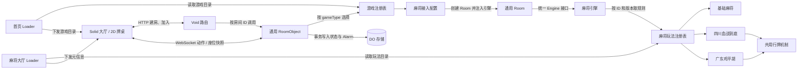
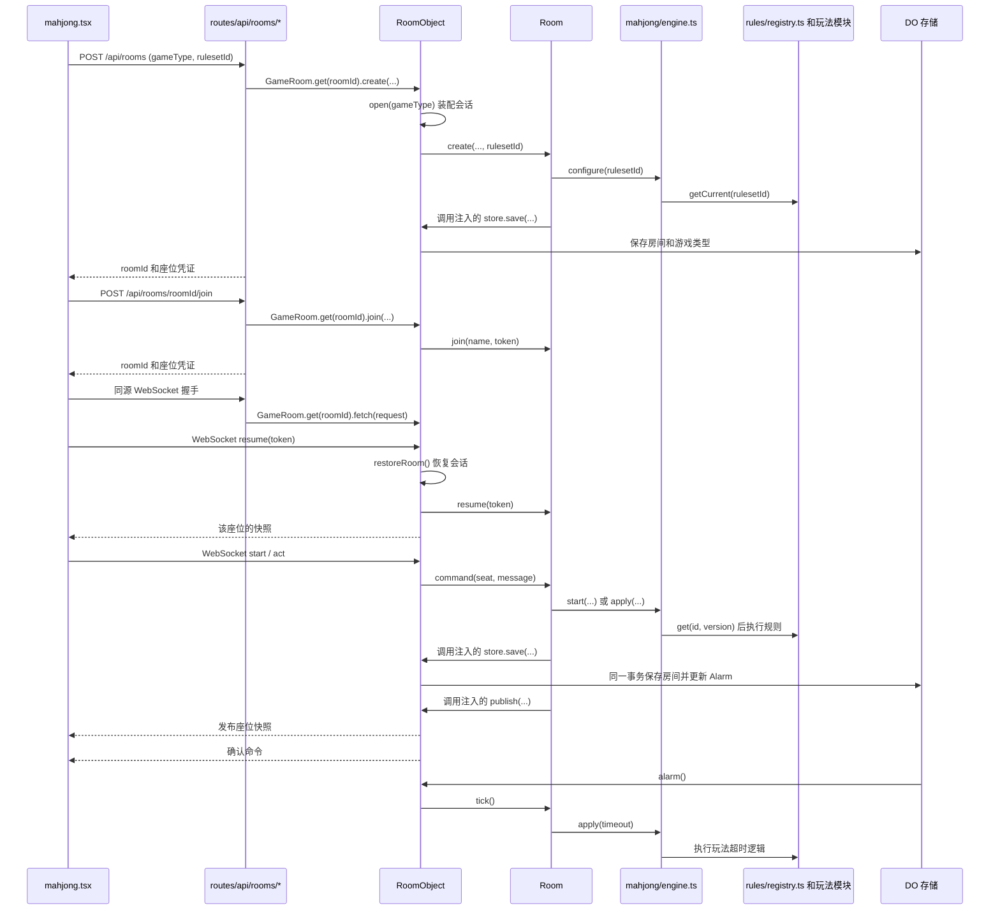

# 四方牌桌架构

`RoomObject` 管理房间的 WebSocket、存储和 Alarm，建房时按请求装配游戏，恢复时读取已保存的游戏类型。`Room` 管理一桌玩家和游戏会话。麻将引擎实现通用的 `Engine` 接口，按建房时选定的玩法运行牌局。每个玩法模块导出自己的规则和元信息，麻将注册表负责装配与版本索引。

## 依赖关系

| 模块 | 职责 |
| --- | --- |
| [`src/room/session.ts`](../../src/room/session.ts) | 成员、房主权限、串行命令、去重、持久化和重连。通过注入的引擎取得容量、执行开局或动作、获取截止时间和席位视图。 |
| [`src/room/engine.ts`](../../src/room/engine.ts) | 通用引擎契约。配置、动作、视图和事件类型由具体引擎提供。 |
| [`src/mahjong/engine.ts`](../../src/mahjong/engine.ts) | 把引擎输入转换成麻将规则调用，检查满员开局，注入洗牌输入，并按保存的玩法版本恢复。 |
| [`src/mahjong/rules/registry.ts`](../../src/mahjong/rules/registry.ts) | 显式登记玩法，索引当前版本和具体版本，导出只包含公开元信息的目录。 |
| [`src/mahjong/rules/contract.ts`](../../src/mahjong/rules/contract.ts) | 玩法定义包含 `id`、`name`、`version`、`seats`，以及 `start`、`apply`、`deadline`、`viewFor`。 |
| [`durable-objects/room-object.ts`](../../durable-objects/room-object.ts) | 共用的原生 Cloudflare 房间对象。按游戏类型选择接入配置，管理 WebSocket、座位绑定、存储和 Alarm。 |
| [`src/game-registry.ts`](../../src/game-registry.ts) · [`src/room/game-adapter.ts`](../../src/room/game-adapter.ts) | 游戏注册表和接入契约。将 `Room` 实例与对应的消息解析函数组成会话，DO 直接调用 `Room` 的生命周期方法。 |
| [`src/mahjong/room-adapter.ts`](../../src/mahjong/room-adapter.ts) | 提供麻将引擎、按牌墙大小生成的随机数据和麻将消息解析。 |
| [`pages/index.tsx`](../../pages/index.tsx) · [`pages/index.server.ts`](../../pages/index.server.ts) | 首页游戏大厅，渲染游戏注册表中的公开目录。 |
| [`pages/games/mahjong.tsx`](../../pages/games/mahjong.tsx) · [`pages/games/mahjong.server.ts`](../../pages/games/mahjong.server.ts) | 麻将玩法卡片、入房表单、房间连接和重连。 |
| [`routes/api/rooms/`](../../routes/api/rooms) · [`src/room/http.ts`](../../src/room/http.ts) | HTTP 建房、加入与 WebSocket 握手。Void 按接口文件生成路由，通过 `GameRoom.get(roomId)` 转到对应对象。 |
| [`board.tsx`](../../src/mahjong/client/board.tsx) | 2D 牌桌按席位视图和可用动作渲染。 |

## 建房、运行与恢复

1. 首页 `/` 显示已接入的游戏。麻将卡片打开 `/games/mahjong`，选择玩法后进入房间表单。带有效房间码的邀请链接直接打开加入表单，旧链接 `/?room=…` 会重定向到麻将页面。
2. 建房请求携带 `gameType` 和所选玩法 ID。`RoomObject` 在并发保护内拒绝已有内存会话的房间，再按请求的游戏类型装配候选会话。`Room.create()` 检查是否已经有持久化的房间记录，并调用 `Engine.configure()` 校验玩法、取得要保存的 ID 和版本。未知游戏或玩法返回 400，房间码冲突时才重试。API 省略麻将玩法时用基础麻将。
3. 加入、WebSocket 消息和 Alarm 通过 `restoreRoom()` 取得会话。WebSocket 路由检查同源并转发握手。客户端用访客凭证恢复座位，服务器按连接携带的座位处理命令。房主发起开局后，引擎按玩法检查人数。玩家动作和超时都由该玩法裁决。
4. 成功更新由 `Room` 先持久化，再广播并确认命令。对象在同一事务内保存房间记录并设置或移除 Alarm。操作到期时，Alarm 唤醒 `Room`，由引擎把超时交给规则。
5. `commandId` 用于同座位命令去重，`decisionId` 由麻将规则校验操作窗口，`revision` 供浏览器丢弃旧快照。规则按席位生成手牌、暗杠和可用动作的视图，底层牌局状态只保存在房间对象中。

当前房间记录包含成员、最近的命令 ID、引擎配置和序列化游戏状态。同一个存储事务保存游戏类型，DO 唤醒时据此恢复对应的引擎和协议。此前没有游戏类型的房间按麻将恢复。Void 使用持久资源名 `mahjong-room`，已保存的房间沿用同一个 DO 绑定和 Cloudflare 迁移记录。麻将读档按 `id + version` 精确命中，缺失版本时报错。[Void 资源锁文件](../../void.lock.json)

## 页面与接口

| 路径 | 输入和用途 |
| --- | --- |
| `GET /` | 读取游戏目录。带有效房间码的旧邀请参数 `room` 会跳转至麻将入房页面。 |
| `GET /games/mahjong` | 显示玩法卡片。有效的 `ruleset` 参数打开对应玩法的房间表单，有效的 `room` 参数预填邀请房间码。 |
| `POST /api/rooms` | 提交 `name`、`gameType` 和可选 `rulesetId`。成功返回 `{ roomId, token }`。缺失或未知游戏、未知玩法返回 400。 |
| `POST /api/rooms/:roomId/join` | 提交 `name`，成功返回 `{ roomId, token }`。房间不存在返回 404，房间已满或已开局返回 409。 |
| `GET /api/rooms/:roomId/socket` | 同源 WebSocket 握手。客户端发送 `resume(token)` 后，按连接绑定的座位收发消息。 |

大厅的玩法卡片由 `pages/games/mahjong.server.ts` 的 SSR Loader 调用 `rulesets.catalog()` 提供。建房时在服务端按玩法 ID 再校验一次。[玩法 Loader](../../pages/games/mahjong.server.ts) · [麻将引擎](../../src/mahjong/engine.ts)

## 新增玩法和游戏

- **新增麻将玩法**。在 `src/mahjong/rules/` 导出带元信息的规则定义，并在 `registry.ts` 登记。大厅选项和建房校验使用同一个目录。沿用已有动作和视图时，这两处就是主要改动。引入规则专用操作或阶段时，在麻将协议和牌桌补相应交互。
- **升级玩法版本**。在注册表中保留仍需读档的版本，登记新版本。同 ID 的最高版本用于新房和大厅目录，已保存的房间继续按记录中的版本恢复。
- **接入另一类游戏**。提供自己的 `Engine` 和消息解析，由 `Engine.configure()` 负责玩法校验和版本选择。用 `defineRoomGame` 组装后在游戏注册表登记名称和房间入口，并为 `/games/<gameType>` 提供页面与棋盘。

## 验证入口

- 麻将和计数游戏验证对不同引擎和协议的接入。[游戏接入测试](../../tests/room-game.test.ts)
- 通用房间测试覆盖持久化、重连、去重与超时，DO 测试覆盖持久化会话恢复等对象行为。[通用房间测试](../../tests/room.test.ts) · [房间对象测试](../../tests/room-object.test.ts)
- 本地 Void Worker 测试覆盖大厅目录、HTTP、WebSocket、三种玩法和 Alarm。[Worker 集成测试](../../tests/worker/room.test.ts)
